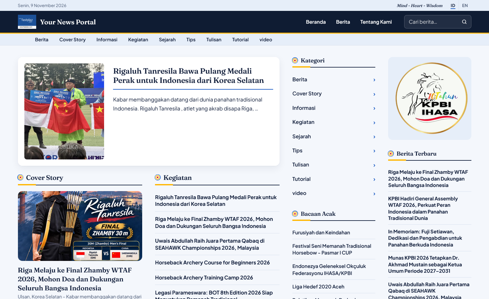

FastPlaz App - Wordpress Loader
===================================

This app was built with the FastPlaz framework, an open source Pascal web
framework. It reads an existing WordPress database and serves the site with
its own themes, without running PHP.

REQUIREMENTS
------------

- FastPlaz 2026 "Hero" or newer (`fastplaz_app`, `TSimpleModel.QuoteValue`)
- Free Pascal 3.2.x
- MySQL client library (libmysql)
- One of:
  - Web Server (apache) with CGI Support, or
  - nothing: the app runs as its own HTTP server (standalone mode)

BUILD
-----

The FastPlaz library is expected in `../../../vendors/fastplaz` (relative to
`source/wordpress`); change `extra.cfg` if yours is elsewhere.

    cd source/wordpress
    ./compile.sh          # Windows: compile.bat

The binary is written to `public_html/wordpress.bin`. Opening
`wordpress.lpi` in Lazarus works too.

Other build scripts in `source/wordpress`:

- `build-wsl.sh`: builds the Linux binary from WSL, compiling on the native
  WSL filesystem because `/mnt/*` is slow.
- `build-docker.sh project`: builds inside Docker (`luri/free-pascal`) so the
  binary runs on hosting servers with an old glibc (cPanel/CloudLinux 8).

INSTALLATION
------------

- Extract this file to your webroot directory
- Copy `config/config-example.json` to `config/config.json` and fill in:
  - `database/default`: the WordPress database, including the table `prefix`
  - `systems/theme`: one of the folders in `public_html/themes`
  - `wordpress`: `base_url` and `upload_url` of the original WordPress site,
    and `plugins/polylang` if the site uses Polylang
  - `hero_banner`, `right_top_banner`: optional banners (wideworld theme)

URLS
----

| URL                          | Page                          |
|------------------------------|-------------------------------|
| `/`, `/id/`, `/en/`          | home page                     |
| `/2014/04/the-post/`         | single post                   |
| `/2014/04/`, `/news/`        | post archive                  |
| `/category/slug/`            | category                      |
| `/tag/slug/`                 | tag                           |
| `/pages/parent/child/`       | WordPress page                |
| `/sitemap.xml`               | sitemap for search engines    |
| `/peta-situs/`               | sitemap page for visitors     |

RUN MODES
---------

One binary, two modes; no code change is needed to switch.

### CGI (Apache)

Apache starts `wordpress.bin` as CGI (`GATEWAY_INTERFACE` is set), and
`public_html/.htaccess` rewrites the friendly URLs. Nothing else to do.

### Standalone HTTP

    cd public_html
    ./wordpress.bin                     # http://127.0.0.1:17845/
    ./wordpress.bin --port=8081         # other options: --address, --static=on|off,
                                        # --max-requests=N, --root=<dir>, --mode=cgi|http

The routes in `source/wordpress/routes.pas` replace the `.htaccess` rewrite
rules, so `/2014/04/the-post/`, `/category/slug/`, `/tag/slug/` and
`/pages/parent/child/` work the same way. Settings are in
`config/config.json`, `systems/server`. Behind nginx or Apache as a reverse
proxy, keep `address` at `127.0.0.1`, set `systems/trust_proxy` to `true`,
and do not let the proxy serve `config/` and `ztemp/`. See
`docs/STANDALONE-deployment.md` in the FastPlaz repository.

THEME TAGS for DESIGNER
----------

A theme is plain HTML in `public_html/themes/<name>/templates/`, the folder
named in `systems/theme`. The app replaces tags in square brackets with
content from WordPress, so a designer can build a theme without touching the
Pascal code. `wideworld` is the most complete example.

### Theme files

| File                        | Used for                                         |
|-----------------------------|--------------------------------------------------|
| `master.html`               | every page except the home page                  |
| `home.html`                 | the home page                                    |
| `includes/*.html`           | pieces pulled in with `[include file="..."]`     |

The content of a post, page, category or search goes where `[$maincontent]`
is, and comes from `public_html/modules/`: `wpnews/detail.html` (post),
`wpnews/category.html`, `wpnews/search.html` and `pages/detail.html`.

### Site and layout

| Tag                                  | Output                                        |
|--------------------------------------|-----------------------------------------------|
| `[$maincontent]`                     | the page content (see above)                  |
| `[include file="includes/head.html"]`| another template file, relative to `templates/` |
| `[$baseurl]`                         | the site URL, for links: `[$baseurl]category/berita/` |
| `[$themefullpath]`                   | URL of the theme folder, for CSS, JS and images: `[$themefullpath]/style/style.css` |
| `[$themepath]`                       | the same, without the site URL: `themes/wideworld` |
| `[sitename]`, `[$slogan]`            | `sitename` and `slogan` from `config.json`    |
| `[lang]`                             | the active language: `id` or `en`, for `<html lang="[lang]">` |
| `[gt text=Latest News]`              | a label in the active language (from `public_html/locale`) |
| `[date format=dd MMM YYYY]`          | today's date in your own format               |
| `[thisurl type=full]`                | URL of the current page                       |
| `[config key=systems/slogan]`        | any value from `config.json`                  |

### WordPress content

All of them are written as `[text mod=<module> func=<function> ...]`; the
options after `func` are optional. `class=` puts your CSS class on the list
the tag writes.

| Tag | Output | Options |
|-----|--------|---------|
| `[text mod=wpnews func=getoption name=blogname]` | a WordPress setting: `blogname`, `blogdescription`, ... | `name` |
| `[text mod=wpnews func=sitelogo class=site-logo]` | the logo from WordPress (Customize > Site Identity), otherwise `public_html/logo.png` | `class`, `variant=light` uses `logo-light.png` on a dark background |
| `[text mod=wpnews func=newstitle]` | ` - <post or page title>`, for `<title>` | |
| `[text mod=wpnews func=today]` | `Senin, 9 November 2026` | `format=year`: `2026`, for the copyright line |
| `[text mod=wpnews func=pagesmenu type=nav]` | menu of the WordPress pages, sub-pages nested | `type=nav` (`<nav>`) or `type=items` (`<li>` only), `id`, `class`, `header`, `footer` |
| `[text mod=wpnews func=langswitch]` | ID / EN links | `class`; languages from `languages` in `config.json` |
| `[text mod=wpnews func=newslist number=6]` | list of the newest posts | `category` (slug, or several: `tips,tutorial`), `number` (max 30), `offset`, `thumb=1` (image), `summary=1` (excerpt), `excerpt` (characters, max 300), `excludelatest=1`, `hideempty=1`, `class` |
| `[text mod=wpnews func=newssection category=kegiatan]` | a section: heading with the category name and its newslist; nothing when the category has no posts | same as `newslist` |
| `[text mod=wpnews func=newshero]` | the newest post, large, with its image | `category`, `excerpt` (default 420), `belowbanner=1` when `herobanner` is above it |
| `[text mod=wpnews func=lastnews]` | simple list of the newest posts | `category`, `title`, `options=summary` or `options=full`, `id`, `class` |
| `[text mod=wpnews func=randomnews number=7]` | random posts | `number` (max 100), `title`, `class` |
| `[text mod=wpnews func=herobanner]` | image carousel from `hero_banner` in `config.json` | `ratio=16:9` |
| `[text mod=wpnews func=rightbanner]` | stacked banners from `right_top_banner` in `config.json` | |
| `[text mod=category func=categorylist]` | categories that have posts | `title`, `class` |
| `[text mod=tag func=tagcloud number=24]` | tag cloud | `number` (max 200), `title`, `style=none` (no random font size) |

### Inside the module templates

`modules/wpnews/detail.html` gets the post as `$news`, and
`modules/pages/detail.html` gets the page as `$page`:

| Tag                                         | Output                          |
|---------------------------------------------|---------------------------------|
| `[$news.post_title]`                        | title                           |
| `[$news.post_content filter=wpautop]`       | the story, with paragraphs      |
| `[$news.post_date dateformat=dd MMM YYYY]`  | date in your own format         |
| `[$news.display_name]`                      | author                          |
| `[$news.post_name]`                         | slug, for building the URL      |
| `[$category_title]`, `[$category_url]`      | category name and URL (in `category.html`) |

Lists are repeated with `foreach`; in `detail.html`, `$terms` is the post's
tags:

    [foreach from=$terms item=$aItem type=table]
      <a href="[$baseurl]tag/[$aItem.slug]/" rel="tag">[$aItem.name]</a>
    [/foreach from=$terms]

SITES USING THIS APP
--------------------

- Portal Pencak Silat Indonesia, https://silatindonesia.com
- Perkumpulan Panahan Berkuda Indonesia (KPBI), https://ihasa.id

